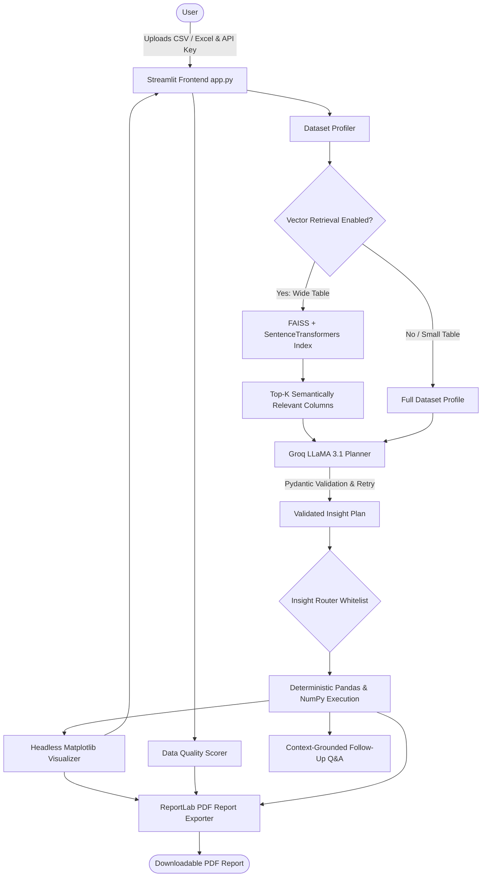

# Product Performance Retrieval & Analytics Agent

An AI-powered data analytics assistant that combines **LLM planning** (Groq LLaMA 3.1) with **deterministic Python computation** (Pandas, NumPy, Matplotlib) and **semantic vector retrieval** (Sentence-Transformers + FAISS) to explore CSV and Excel datasets safely, reproducibly, and explainably.

---

## Architecture

The system enforces a strict architectural boundary: **the LLM reasons and plans, while deterministic Python code executes**.



---

## Features

- **Multi-Format Ingestion:** Instant profiling of `.csv`, `.xlsx`, and `.xls` files.
- **Configurable Data Quality Scoring:** Deterministic 0–100 score quantifying missing cells, duplicate records, and IQR statistical outliers with user-tunable weights.
- **Vector Column Retrieval for Wide Datasets:** Uses `all-MiniLM-L6-v2` and FAISS vector indexing to semantically select top-k relevant columns when profiling wide datasets, conserving LLM token budget.
- **Pydantic-Validated LLM Planning:** Recommends targeted analytical insights using Groq LLaMA 3.1 with strict schema validation, exponential backoff retries, and fallback safety.
- **Deterministic Python Execution:** Dispatches to a fixed whitelist of deterministic routines:
  - `distribution`: Descriptive statistics (mean, spread, quartiles).
  - `missing_data`: Null count and percentage auditing.
  - `categorical_patterns`: High-frequency categorical distribution.
  - `relationships`: Pearson correlation matrix.
  - `outliers`: Tukey IQR boxplot anomaly detection.
  - `schema`: Structural data type and nullity inspection.
- **Interactive Visualizations & Grounded Follow-Up Q&A:** Matplotlib-generated visualizations coupled with an LLM conversational assistant strictly constrained to analytical results.
- **Comprehensive PDF Report Export:** Generates publication-ready PDF summaries via ReportLab, including executive metrics, data quality scores, embedded charts, and Q&A history.
- **Structured Privacy-Preserving Telemetry:** Records LLM latency, prompt character size, and token usage without logging raw customer data or tabular rows.

---

## Data Quality Score Formula

The data quality score quantifies tabular data cleanliness on a scale from **0 to 100**:

$$\text{Score} = \max\left(0, \min\left(100, 100 \times \left(1 - w_{\text{missing}} \cdot R_{\text{missing}} - w_{\text{dup}} \cdot R_{\text{dup}} - w_{\text{outlier}} \cdot R_{\text{outlier}}\right)\right)\right)$$

### Component Metrics:
1. **Missing Ratio ($R_{\text{missing}}$):**
   $$R_{\text{missing}} = \frac{\text{Total Null Cells}}{\text{Total Cells}}$$
2. **Duplicate Ratio ($R_{\text{dup}}$):**
   $$R_{\text{dup}} = \frac{\text{Duplicate Rows}}{\text{Total Rows}}$$
3. **Outlier Ratio ($R_{\text{outlier}}$):**
   $$R_{\text{outlier}} = \frac{\sum_{c \in \text{numeric}} \text{Outlier Cells}_c}{\text{Total Rows} \times \max(1, |\text{numeric columns}|)}$$
   An outlier cell is defined as $x < Q_1 - 1.5 \times \text{IQR}$ or $x > Q_3 + 1.5 \times \text{IQR}$.

### Configurable Weights:
Default weights are $w_{\text{missing}} = 0.4$, $w_{\text{dup}} = 0.3$, $w_{\text{outlier}} = 0.3$ (normalized such that $\sum w_i = 1.0$). Weights can be customized in the UI sidebar or via `QualityWeights` in code.

---

## Installation & Setup

### Prerequisites
- Python 3.10+
- A [Groq API Key](https://console.groq.com)

### 1. Local Environment

```bash
# Clone the repository
git clone https://github.com/your-username/Product-Performance-Retrieval-Agent.git
cd Product-Performance-Retrieval-Agent

# Create and activate virtual environment
python -m venv .venv
source .venv/bin/activate  # On Windows: .venv\Scripts\activate

# Install pinned dependencies
pip install -r requirements.txt

# Set your Groq API key (optional, can also be entered in the UI)
export GROQ_API_KEY="your-groq-api-key"   # Windows PowerShell: $env:GROQ_API_KEY="your-groq-api-key"

# Run Streamlit application
streamlit run app.py
```

### 2. Docker Deployment

Using Docker Compose:
```bash
# Provide API key in environment or pass at runtime
export GROQ_API_KEY="your-groq-api-key"
docker-compose up --build
```

Using Docker CLI directly:
```bash
docker build -t analytics-agent .
docker run -p 8501:8501 -e GROQ_API_KEY="your-groq-api-key" analytics-agent
```
Access the application at `http://localhost:8501`.

---

## Evaluation Benchmark

The repository includes an evaluation harness (`eval/`) that tests intent classification and router accuracy across 24 test cases over 3 realistic sample datasets (`ecommerce_sales.csv`, `customer_churn.csv`, `employee_attrition.csv`).

To run the evaluation harness:
```bash
python eval/run_eval.py
```

### Measured Benchmark Results (`results/eval.json`)
The script evaluates router dispatch and writes results to `results/eval.json` and `results/eval_summary.md`:

| Metric | Result |
| :--- | :--- |
| **Total Test Cases** | 24 |
| **Correct Predictions** | 24 |
| **Overall Accuracy** | **100.00%** |
| **Average Latency** | **0.02 ms** |
| **Failure Types** | None |

#### Per-Insight Breakdown:
| Insight Route | Precision | Recall | F1 Score |
| :--- | :---: | :---: | :---: |
| `categorical_patterns` | 1.00 | 1.00 | 1.00 |
| `distribution` | 1.00 | 1.00 | 1.00 |
| `missing_data` | 1.00 | 1.00 | 1.00 |
| `outliers` | 1.00 | 1.00 | 1.00 |
| `relationships` | 1.00 | 1.00 | 1.00 |
| `schema` | 1.00 | 1.00 | 1.00 |

*Note: All evaluation test cases created for this harness are annotated with `"needs_human_review": true` in `eval/test_cases.json`.*

---

## Test Suite & Linting

Run tests and linting with single commands:

```bash
# Run pytest test suite (32 unit tests across all modules)
pytest -v

# Run Ruff linter
ruff check .
```

---

## Limitations

1. **In-Memory Scale:** Designed for small to medium datasets fitting in memory (< 200MB). For multi-gigabyte files, a distributed query engine (e.g. DuckDB, Polars, or BigQuery) is recommended.
2. **Fixed Routable Whitelist:** Execution is constrained to 6 pre-built deterministic routines to guarantee zero arbitrary code execution vulnerabilities. Arbitrary code synthesis is intentionally disabled.
3. **Groq API Rate Limits:** Subject to standard Groq RPM/TPM limits on free or tier-1 API plans.
4. **Vector Retrieval Latency:** On initial invocation of the column vector index, Sentence-Transformers downloads model weights locally (~90MB).

---

## Screenshots & Live Demo

- **Live Demo:** `[Deploy on Streamlit Community Cloud](https://your-app-url.streamlit.app)`
- **UI Screenshot:**


---

## License

This project is licensed under the [MIT License](LICENSE).
